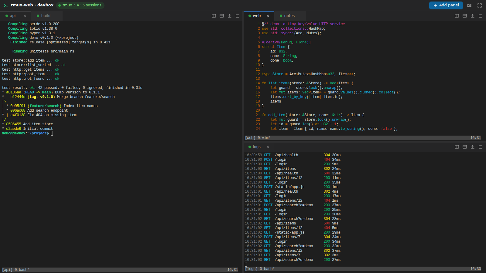

# tmux-web

Browser panels for your tmux sessions, served by one Rust binary, with a badge on every session
that runs Claude Code.



- **Panels are tmux sessions.** Each panel is a real terminal (xterm.js) attached to a session.
  The tab title is always the tmux session name and follows renames made in tmux.
- **Docking layout.** Drag a tab to reorder it, onto another group to stack it, or onto an edge
  to split. The split buttons open a session picker for the new pane. Maximise a group to fill
  the window (header button, double-click a tab, or Ctrl+Shift+Enter) and restore it the same way.
- **The layout lives on the server.** Close Chrome, restart tmux-web, come back: same panels,
  same splits, same maximised group.
- **Paste files.** Paste (Ctrl+V), drop, or pick any file: it is uploaded to the server and its
  path is pasted into the terminal. For images, Claude Code turns the pasted path into `[Image #1]`.
- **Copy text.** Selecting copies (on by default), plus Ctrl+Shift+C, Ctrl+C while text is
  selected, and the right-click menu. tmux copy mode also reaches your clipboard (OSC 52).
- **Finger scrolling.** On a touch screen a vertical swipe on a panel scrolls the tmux history
  (tmux copy mode), without turning on tmux's `mouse` option; programs that track the mouse
  get the swipe as a wheel instead.
- **Ctrl+click opens links** (Cmd+click on macOS), including OSC 8 hyperlinks.
- **Claude badges.** tmux-web scans the panes (in memory only) and badges the sessions that run
  Claude Code in the session picker, the empty state and the tabs.
- **Bell tab flash.** When the program in a panel that is out of sight rings the terminal bell,
  its tab flashes orange until you focus that panel.
- **Terminate sessions.** The session picker has a red cross on each row that kills that tmux
  session after a confirmation and closes its panels.
- **Crash recovery is left to tmux itself**, for example tmux-resurrect and tmux-continuum;
  tmux-web keeps no snapshots and restores nothing.

## Install

```sh
cargo build --release
install -m 0755 target/release/tmux-web ~/.local/bin/
```

Requirements: Linux, tmux 3.2 or newer (tested with 3.4), a Rust toolchain to build it and a
modern browser. Claude Code is optional: it is only needed for the badges and the bell hook
below. The web UI is embedded in the binary; there is no JavaScript build step.

## Run

```sh
tmux-web                         # http://127.0.0.1:7690, default tmux server
tmux-web -L work                 # a tmux server started with `tmux -L work`
```

From another machine, forward the port and open `http://localhost:7690`. A localhost URL is a
secure context, so the browser clipboard API works:

```sh
ssh -L 7690:127.0.0.1:7690 your-host
```

As a systemd user service, so it keeps running outside tmux:

```sh
cp contrib/tmux-web.service ~/.config/systemd/user/
systemctl --user daemon-reload
systemctl --user enable --now tmux-web
loginctl enable-linger "$USER"   # optional: keep running while logged out
```

The unit uses `KillMode=process`, so tmux servers that tmux-web starts (a new session from the
UI, a page opened while tmux is down) survive a restart of the service. It reads optional settings from
`~/.config/tmux-web/env` (`KEY=value` lines using the environment variables below, for example
`TMUX_WEB_LISTEN=192.168.1.5:7690`).

## Keys and mouse

| Action | How |
|---|---|
| Copy | select text (copy-on-select), Ctrl+Shift+C, Ctrl+Insert, or Ctrl+C while text is selected |
| Paste text, an image or a file | Ctrl+V, Ctrl+Shift+V, Shift+Insert (Cmd+V on macOS), or drop a file |
| Open a link | Ctrl+click (Cmd+click on macOS) |
| Maximise / restore | Ctrl+Shift+Enter, double-click a tab, or the header button |
| Panel menu | right-click (Shift+right-click when the program uses the mouse) |
| Scroll the history | swipe up or down on a touch screen (a swipe down shows earlier output) |

With `set -g mouse on` in tmux, hold Shift to select text with the browser instead of tmux.

## Claude Code: flash the tab when it needs you

This is optional. Claude Code hooks run without a terminal, so `printf '\a'` alone does not reach
the pane. This script rings the bell in the pane Claude Code runs in; save it as
`~/.claude/hooks/tmux-bell.sh` and make it executable:

```sh
#!/bin/sh
# Ring the terminal bell in this tmux pane (Claude Code hooks have no terminal of their own).
[ -n "$TMUX_PANE" ] || exit 0
tty=$(tmux display-message -p -t "$TMUX_PANE" '#{pane_tty}' 2>/dev/null) || exit 0
[ -c "$tty" ] && printf '\a' > "$tty" 2>/dev/null
exit 0
```

Then run it when Claude Code finishes or asks for you, in `~/.claude/settings.json`:

```json
{
  "hooks": {
    "Stop": [
      { "hooks": [{ "type": "command", "command": "~/.claude/hooks/tmux-bell.sh" }] }
    ],
    "Notification": [
      { "hooks": [{ "type": "command", "command": "~/.claude/hooks/tmux-bell.sh" }] }
    ]
  }
}
```

The tab of that session flashes whenever its panel is out of sight.

## Starting tmux

Opening the page also starts tmux when it is not running: tmux-web creates the session named by
`--default-session` (default `main`), a plain login shell on this machine. This happens once per
page load. If tmux is stopped while a page is open, it stays stopped until you press
**Start tmux**, so `tmux kill-server` is never undone behind your back.

## Security

tmux-web gives shell access to whoever can reach it.

- It listens on `127.0.0.1` by default.
- On any other address it requires a token: `--token`, or one generated into
  `~/.local/state/tmux-web/token`. The log says where the token is stored but never shows it;
  when stderr is a terminal, the sign-in URL is also printed there. Open
  `http://host:7690/?token=…` once to set a cookie. `--no-auth` turns this off explicitly.
- WebSocket upgrades and state-changing requests must come from the same origin, and
  state-changing requests need an `X-Tmux-Web: 1` header. Without a token, the `Host` header must
  be localhost, an IP address, this machine's hostname or an `--allow-host` entry, which blocks
  DNS-rebinding attacks.
- Behind a reverse proxy with its own authentication, add `--allow-host <public hostname>`.
- Programs inside tmux sessions started by tmux-web do not see tmux-web's settings or token. A
  tmux server started by an older version keeps them until it is restarted.
- `?token=` only works when opening the page. API and WebSocket calls use the cookie or an
  `Authorization: Bearer` header.
- Off this machine, use HTTPS (a TLS proxy) or an SSH tunnel: on plain HTTP the sign-in cookie
  travels unencrypted.
- Prefer `TMUX_WEB_TOKEN` or the token file over `--token`: command-line arguments are visible to
  other users in the process list.
- Without a token, on 127.0.0.1, every local user and process can use tmux-web. On a shared
  machine, set a token.
- Programs in a panel can write your browser clipboard through OSC 52 (a terminal escape code),
  without asking.

### Behind Tailscale

Put `tailscale serve` in front of tmux-web, which stays on 127.0.0.1:7690. Serve only the tailnet,
not the internet (not `tailscale funnel`):

```sh
export TMUX_WEB_TOKEN=<a long random token>   # or use the token file
tmux-web serve --allow-host <machine>.<tailnet>.ts.net
tailscale serve --bg 7690
```

Tailscale's access rules decide which devices can reach it; tmux-web's token stops other programs
on the same machine. Open `https://<machine>.<tailnet>.ts.net/?token=…` once to set the cookie.

## Configuration

Every option also has an environment variable; see `tmux-web --help` and
`tmux-web serve --help`. State lives in `$XDG_STATE_HOME/tmux-web` (default
`~/.local/state/tmux-web`): `layout.json`, `uploads/` (uploaded files, deleted after 7
days) and `token`.

## Development

```sh
cargo test                          # unit and integration tests (isolated tmux sockets)
cd e2e && npm ci && npx playwright-core install chromium && npm test   # browser tests
```

The browser tests use the Chromium binary at `$TMUX_WEB_CHROME` (default: Playwright's cached
Chromium). The design and API contract are in `docs/CONTRACT.md`. Front-end libraries are
vendored under `web/vendor/` (dockview-core 8.5.1, xterm.js 6.0.0 and addons); their type
definitions are in `vendor-types/`.

## License

MIT, see [LICENSE](LICENSE).
